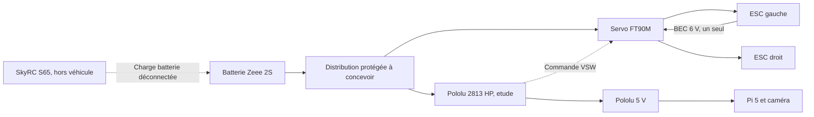

<!-- alimentation-r2 -->
> **Sélection active révisée le 15 octobre 2026.** Pack actif Spektrum G1 2S IC5 5 Ah / 37 Wh, énergie utilisable supposée 29,6 Wh. Régulateur actif D42V55F5. S65 + BEEC1067 + équilibrage dédié. Les calculs Zeee précédents ne sont plus ceux de la batterie active.
> [État électrique courant](../verification-alimentation/README.md) · [Raccordements](../verification-alimentation/integration.md). Les références différentes dans les documents ci-dessous sont historiques. Qualification matérielle non réalisée ; confirmations restantes explicites.
<!-- /alimentation-r2 -->

# Alimentation et charge — V3

Trois dossiers : [batterie Zeee 2S 5 200 mAh](../batterie/README.md), [régulateur Pololu D24V90F5](../regulateur-alimentation/README.md), [chargeur SkyRC S65](../chargeur-batterie/README.md). Sélection de conception ; aucune commande ou installation physique.

Les références batterie et régulateur sont identifiées sur Amazon.com. Amazon.fr bloque les pages et sa disponibilité ne peut pas être déduite. Le S65 est documenté et signalé sur Amazon.de par un comparateur, sans ASIN fiable récupéré. Le panier Amazon France, les prix et les frais restent à vérifier.

## Énergie et autonomie

Un seul pack annoncé 5,2 Ah ×7,4 V donne **38,48 Wh nominaux**. Avec la fraction utilisable **supposée** de 80 %, **30,784 Wh**. La réserve de 20 % n’est pas une mesure ni un seuil de coupure. Le second pack du lot reste hors véhicule : échanger les batteries ne valide pas une autonomie sur une charge.

| Objectif | Puissance totale moyenne maximale, scénario 80 % |
| --- | ---: |
| 45 min à20 km/h | 41.05 W |
| 20 min à40 km/h | 92.35 W |
| 10 min à40 km/h | 184.70 W |

Ce total comprend moteurs, ESC, direction, Pi, caméra, refroidissement et pertes. À titre d’hypothèse, une branche Pi/caméra consommant 10 W à la batterie laisserait environ **31,05 W** pour propulsion et direction au point 45 min. Une capacité mesurée plus faible, un arrêt plus précoce ou davantage de frottement réduit cette marge. Les courants 30 A des ESC et 9 A du régulateur sont des capacités, pas la consommation permanente du véhicule.

À5 A de sortie Pi, le régulateur fournit 25 W ; avec 90 % de rendement supposés, il prélève 27,78 W, soit **4,34 A à6,4 V**. Un fusible de branche placé à l’entrée ne doit donc pas être dimensionné par simple recopie du courant de sortie. Les sections, pointes, chutes et protections du faisceau doivent être mesurées et dimensionnées.

## Distribution prévue

La [surveillance et la coupure 2S](../protection-batterie/README.md) ont maintenant un dossier d’étude : carte analogique V3 à fabriquer, interrupteur Pololu pour la branche Pi et relais Crydom pour les moteurs. Ces éléments ne sont pas qualifiés au banc. Distribution, fusibles, faisceau, dissipateur et protections contre les transitoires restent à définir. Le régulateur ne protège pas à lui seul la LiPo contre une décharge profonde.

## Liaison du régulateur à la Pi

Le Pololu n’annonce pas de source USB PD. Deux possibilités documentées : USB-C avec une interface de source et un câble de puissance appropriés ; ou rails 5 V du connecteur 40 broches avec protections externes et fils courts. Pour l’étude, la seconde est proposée. Ce schéma est fonctionnel : le faisceau et ses protections restent à dimensionner et vérifier avant mise sous tension.

Broches physiques Pi proposées : 2 et4 (5 V), plusieurs GND dont6 et9, repérage à vérifier. Il s’agit des rails d’alimentation, pas de GPIO de commande ; la batterie 7,4/8,4 V et les BEC6/7,4 V restent hors de ces rails. Ne pas utiliser de plaque d’essai pour la puissance ni alimenter la Pi simultanément depuis deux sources.

Le [livre blanc officiel Raspberry Pi, page PDF9](../regulateur-alimentation/notices/Raspberry-Pi-5-alimentation-USB-PD-livre-blanc-2026.pdf) précise deux réglages possibles après validation de la branche : `PSU_MAX_CURRENT=5000` dans l’EEPROM déclare la capacité de la source, tandis que `usb_max_current_enable=1` dans `config.txt` relève le plafond USB partagé à1,6 A. Le premier entraîne aussi le second automatiquement. Ils ne créent ni courant supplémentaire ni négociation PD. Tenir compte du budget partagé caméra/ventilateur et mesurer la tension à la Pi. Aucun réglage n’a été appliqué.

## Charge et arrêt basse tension

S65 en mode LiPo BALANCE 2S, fin4,20 V/cellule. Le choix initial de2,6 A reste sous1C ; la valeur5,2 A ne s’utilise qu’avec la notice du pack reçu. La charge requiert les deux liaisons, puissance et équilibrage ; vérifier genre des prises et alignement XH. Aucun adaptateur ou prolongateur n’est supposé inclus.

L’étude de [protection 2S](../protection-batterie/integration.md) propose deux voies locales par cellule : avertissement typique à 3,566 V, puis demande indépendante de coupure à 3,353 V en descente. Tolérances, hystérésis et essais sont documentés ; aucune protection réelle n’est validée. Le minimum fabricant de 3,2 V et les creux sous charge imposent une marge. La fenêtre de tension ne garantit pas un délai fixe d’arrêt Linux. Le port d’équilibrage sert à la mesure, pas à la puissance.

## Contrôles avant validation des objectifs

Mesurer capacité et Wh utilisables, température, tension par cellule et pointes. Tester le régulateur en charge et pendant l’accélération des deux moteurs ; contrôler sous-tension Pi, stabilité de la caméra et courant USB. Faire ensuite des parcours distincts à20 et40 km/h, vidéo active, sur un espace approprié. Les avis recueillis n’attestent ni ces performances ni notre exemplaire.

[Calculs structurés](dimensionnement.json), [modèles 3D](3D/README.md), [index composants](../README.md).
