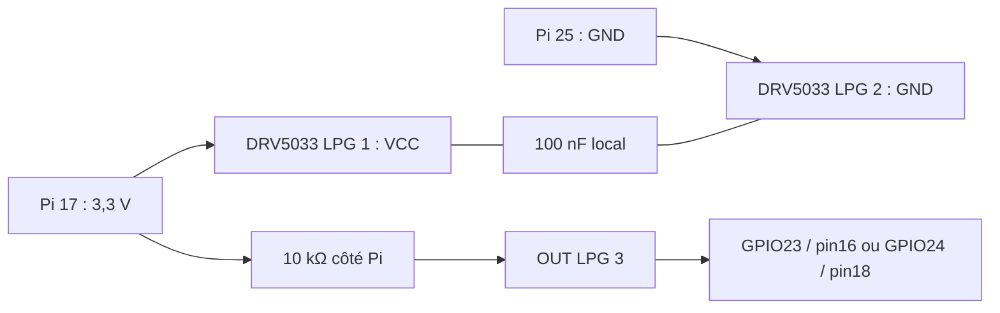

# Montage - KEMET C315C104K5R5TA

# Raccordement des deux voies de vitesse

Deux voies identiques, alimentées par le **3,3 V du Pi**. Aucun 5 V, BEC 6 V ou positif batterie sur ces entrées. Chaque capteur garde un GND de référence. Pi et capteurs s’allument ensemble : pas d’alimentation indépendante susceptible de renvoyer du courant dans un Pi arrêté.

| Liaison | Gauche | Droite |
| --- | --- | --- |
| 3,3 V commun | Broche physique 17 → VCC LPG 1 | Même départ, dérivation en Y → VCC LPG 1 |
| GND commun | Broche physique 25 → GND LPG 2 | Même départ, dérivation en Y → GND LPG 2 |
| OUT | LPG 3 → GPIO23, broche physique 16 | LPG 3 → GPIO24, broche physique 18 |
| Rappel | R1 10 kΩ : OUT → 3,3 V côté Pi | R2 identique |
| Découplage | C1 100 nF : VCC → GND au capteur | C2 identique |

Le plan TI est en **vue de dessus** ; ne pas lire les pattes en retournant le composant sans inverser la vue. Le STEP nomme VCC/GND/OUT et son repère est défini dans la provenance. Confirmer le repère de la pièce et la figure TI p.4 avant soudure. Ne pas reprendre le brochage du SOT-23 DBZ.

Les quatre contacts ajoutés au Molex sont 16, 17, 18, 25. Le faisceau actif passe de 9 à **13 contacts montés**, avec cinq de réserve, donc **18 contacts à provisionner**. Les broches 2/4/6/9/14/20 du connecteur amovible restent vides : la puissance 5 V de la Pi reste séparée. Les anciens STEP et PDF GPIO décrivent leurs anciennes versions, pas ce faisceau.

Réutiliser le fil multibrin 22 AWG du lot prévu. Les dérivations 3,3 V et GND sont des jonctions en Y soudées, isolées individuellement et maintenues ; ne pas doubler deux fils dans un contact Molex prévu pour un seul. Longueurs après implantation. Faire suivre chaque signal de sa référence GND ; garder ces petits faisceaux à distance des phases moteur et de la puissance. Aucun blindage ni filtre RC supplémentaire n’est déclaré nécessaire sans mesure.

Un OUT flottant côté capteur, ou un câble débranché, peut ressembler à une roue arrêtée : ces capteurs ne constituent pas un dispositif d’arrêt de sécurité. La commande devra appliquer ses propres contrôles de plausibilité et son délai de perte Wi-Fi.

## Implantation mécanique réservée

Deux aimants identiques par roue à 180°, axes magnétiques parallèles à l’axe de roue, avec la même face polaire exposée pour une répétabilité initiale. Le DRV5033 est omnipolaire ; aucun passage par une polarité opposée n’est nécessaire pour le réarmer. Il faut en revanche que le champ redescende sous le seuil de relâchement entre aimants.

Placer la face sensible du capteur face aux disques. Commencer les essais avec **1 à 2 mm d’entrefer extérieur**, sans contact possible malgré le voile et les jeux. Cette plage est une position de départ, pas une portée garantie. La profondeur du point sensible, les métaux voisins, les moteurs, les aimants et les tolérances modifient le champ. Exiger deux impulsions propres et un retour haut entre elles sur chaque tour complet.

Réserver une rétention mécanique captive des aimants et un maintien du capteur ; ne pas retenir l’aimant par attraction seule ni laisser la colle seule sans qualification. Pas d’usinage de l’aimant. Un rayon de 12 mm sert uniquement au calcul illustratif des efforts ; aucun disque porteur, poche ou support de châssis n’est conçu ici. La disposition symétrique réduit le balourd théorique, sans garantir l’équilibrage de l’ensemble réel.

## Acquisition

Compter **les fronts descendants uniquement** : deux fronts par tour si la pose est correcte. Utiliser des événements horodatés du système GPIO compatible Pi 5 ; vérifier les pertes avec caméra et Wi-Fi actifs. Ignorer la phase d’établissement à la mise sous tension et initialiser le comptage après stabilisation ; la fiche TI décrit une impulsion au démarrage. Pas d’anti-rebond long qui supprimerait les événements à haute vitesse.

Avec le diamètre de roulement D en mètres : `v_km_h = f_Hz × π × D × 3,6 / 2`. Pour D nominal de 63 mm, 40 km/h correspond à 3 368 tr/min et 112,28 Hz par roue. Calibrer D par une distance roulée sous charge. Un capteur par roue mesure une rotation sans sens de marche ; il ne distingue pas arrêt, rupture de fil et champ permanent. Le patinage fausse la vitesse au sol. En virage les deux roues doivent pouvoir tourner à des vitesses différentes : aucune égalisation permanente gauche/droite.

La CAO constructeur est conservée avec sa géométrie et ses couleurs. Ses arrondis et longueurs ne remplacent pas les tolérances du lot. La prose générique C0G de RS ne concerne pas cette référence X7R : la fiche spécifique KEMET prime.
