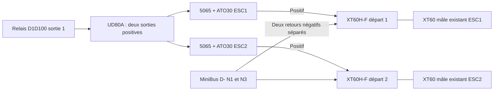

# Intégration et notice de montage des deux prises

Le + de chaque F vient de **la sortie de son propre ATO30**. Le - revient individuellement vers N1 ou N3 du MiniBus D-. Les deux pôles d'une prise portent le même courant de boucle ; ne pas partager une seule prise pour les deux ESC. N2 reste le retour batterie et N4 l'électronique. Les trois prises de phases 3,5 mm entre ESC et moteur restent distinctes.

## Fils et limites

AMASS recommande **12 AWG**, environ **3,31 mm²** de cuivre. Cette section convient nominalement aux fils du Blue Sea 5065 ; les ESC conservent leurs fils **16 AWG / 75 mm** d'origine. Pour les queues à souder et les retours de ces prises, proposition de 12 AWG court, longueur après implantation. Les anciens exemples de 4 mm² restent des comparaisons de pertes, **pas une autorisation de forcer du 4 ou 6 mm² dans un godet XT60H**. Si un tronçon de 4 mm² est nécessaire, choisir ensuite un raccord de transition qualifié ; ne pas éliminer des brins pour faire entrer un fil.

Le tronc commun 6 mm² arrive au répartiteur ; il ne passe pas dans les deux nouveaux XT60H. Les raccords 5065-vers-F et D--vers-F, cosses, gaine et maintien du faisceau restent à sélectionner. Le capot isole les godets, mais aucune force de traction admissible n'est publiée : prévoir une retenue des fils par le châssis, sans utiliser la soudure comme ancrage.

Référence de fil maintenant proposée : [BNTECHGO SW12G68008F10C2, 12 AWG rouge/noir](../cable-puissance-12awg/integration.md), ASIN B01ABOPMEI. Gaine **Ø4,5 ±0,1 mm annoncée**, contre Ø4,2 estimée dans l'ancien modèle câblé : vérifier le passage des capots du lot, dont les perçages CAO étaient également estimés. Les modèles illustratifs anciens restent distincts ; mesurer avant fixation ou modification de capot.

Scénario : **20 A par ESC**, référence de travail **30 A par prise**. Aucun dispositif ne garantit aujourd'hui cette limite individuelle ; 40 A total peut se répartir 30+10, 35+5 ou autrement. Les 100 A de pointe de l'ESC ne sont pas une capacité démontrée du raccord. Le fusible ATO30 peut laisser durer une surcharge ; il n'est pas un limiteur à 30 A. Valider courant RMS, pointes, baisse de tension et échauffement sur la durée prévue, y compris démarrage et freinage.

## Préparation et soudure

1. Débrancher batterie **et prise d'équilibrage** ; aucune soudure ni mesure d'ohmmètre sur le faisceau alimenté. Travailler sur les prises neuves détachées, sans couper ou modifier les fils du pack.
2. Identifier les contacts : **F = logements femelles, M = broches mâles**. Lire les +/-, dessiner le raccord selon la vue choisie ; avant et arrière s'inversent visuellement. Ne pas déduire la polarité de la couleur du plastique.
3. Faire passer les fils dans le capot avant soudure. Présenter le cuivre dans le godet pour régler le dénudage, tous les brins à l'intérieur sans cuivre libre hors de la protection. Aucune longueur ou température de soudage fabricant exacte confirmée : régler selon fil, alliage, outil et procédure applicable au lot.
4. Souder chaque conducteur séparément, éviter pont d'étain et chauffe prolongée du PA. Un connecteur complémentaire **neuf et totalement hors tension** peut maintenir l'alignement pendant l'opération ; ne pas utiliser une batterie comme gabarit.
5. Laisser refroidir ; examiner remplissage, brins, isolation, position des contacts et état du boîtier. Vérifier que les godets sont isolés entre eux et entièrement couverts ; clipser sans forcer le capot. Toute soudure froide, plastique déformé ou contact mobile impose de reprendre la pièce.
6. Maintenir les fils près de la prise avec une retenue dédiée, garder l'accès à la prise et aux fusibles. Débrancher en tenant les corps, sans tirer sur les fils. Protéger les F alimentées des objets métalliques et débris.

Ce protocole du projet n'est pas une notice AMASS officielle de soudage. La vidéo SoloGood identifiée montre le sujet exact, mais son simple référencement ne prouve pas une température, un temps ou une qualification V3. Aucun couple de serrage pour ces godets soudés ; les bornes vissées du répartiteur et du MiniBus suivent leurs propres notices.

## Vérifications

Hors tension : continuité de chaque + vers **son** fusible, chaque - vers D-, isolement +/-, polarités et séparation des deux branches. Mesurer la polarité de la source avant tout raccordement des ESC, après préparation d'une première alimentation limitée et supervisée. Vérifier emboîtement complet, contacts tenus, capots et efforts de traction raisonnables sur le faisceau fini.

Mesurer chute de tension de la paire accouplée et températures des deux pôles, soudures et fils sous les usages représentatifs ; noter ambiante et durée. Une résistance mesurée inclut les points de prise de mesure : séparer les contributions par mesure quatre fils si nécessaire. Inspecter après vibrations et cycles de branchement. Pas de test volontaire de court-circuit de LiPo.

L'interface XT60 batterie reste distincte : scénario commun **44,39 A**, révision inconnue. Elle doit être qualifiée ou remplacée avec une chaîne compatible pack/chargeur adaptée ; les deux prises d'ESC ne résolvent pas ce point. Les performances de 40 km/h et d'autonomie ne sont pas validées par cette sélection.

[Protections des moteurs](../protection-branches-moteurs/integration.md), [répartiteur](../repartition-moteurs/integration.md), [distribution](../distribution-alimentation/integration.md), [batterie](../batterie/README.md).

<!-- faisceau-puissance-v3 -->

Complément du14octobre2026 : [cosses, raccords, gaine, maintien et câble principal](../faisceau-puissance/README.md), avec [raccordements et notice de préparation](../faisceau-puissance/integration.md). Sélection d’étude, sans achat ni qualification matérielle.
