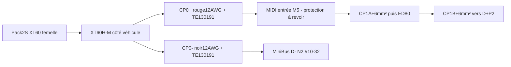

# Variante XT60 non retenue

Les huit premiers STEP et les dossiers prise-xt60h-m/fils-12awg constituent l’étude préparée avant la réponse utilisateur. Ils ne sont pas à ajouter au cordonIC5 actif. Les44 A continus n’y sont pas justifiés et leMIDI 60 A doit être recoordonné. Lescosses et la référenceATUM restent communes. Le lotBNTECHGO 12 AWG est conservé pour lesbranches ESC, pas racheté pourCP0.

# Intégration et montage

1. Version d’étude conservant le pack Zeee 2S XT60 actuel. La prise réelle du pack, son sexe par contacts, la polarité, les fils d’usine et la révision doivent être contrôlés. Aucun changement de batterie n’a été décidé et aucun pack n’est modifié.

2. CP0+ : contact positif de la XT60H-M → fil rouge12 AWG → TE 130191 → entrée du porte-fusible MIDI M5. Le MIDI reste au plus près du pack : la longueur 0,20m est une provision d’approvisionnement, pas une prescription de tronçon positif non protégé.

3. CP0- : contact négatif de la XT60H-M → fil noir12 AWG → TE 130191 → MiniBus négatif D- N2, goujon #10-32. L’œilØ5,26 offre un passage nominal ; vérifier paume, rondelle, appui et fermeture du capot. Conserver l’écrou #10-32 d’origine ; ne pas monter un écrou M5.

4. Le positif aval reste MIDI sortie → CP1 A+6 mm² → ED80 → CP1B+6 mm² → D+ P2. CP2+/CP3+ et l’admission minimale6 mm² de l’UD80 A ne changent pas. Pas d’adaptateur XT60→XT90 et pas de fil 6 mm² forcé dans un godet12 AWG.

5. Soudure côté XT60 : travailler sur le cordon détaché, sans batterie ni équilibrage. Passer le capot avant terminaison, contrôler ± sur la pièce réelle, dénuder selon le godet mesuré, étamer fil et godet sans grossir excessivement le faisceau, puis souder et immobiliser jusqu’au refroidissement. Aucun brin retiré. La géométrie CAO n’est pas une longueur de dénudage constructeur. Utiliser une prise complémentaire non alimentée comme maintien ; ne pas utiliser le pack comme gabarit.

6. Sertissage côté cosse : manchons déjà enfilés ; conducteur cuivre non pré-étamé à la soudure, avec tous ses brins. Le guide TE associe130191 aux49935 ou58546-1/matrice 58545-1. La notice 408-1542 décrit49935 et la chambre12-10 AWG : dénudage standard6,35-7,14 mm, paume orientée selon la figure et canon centré. Faire confirmer l’outil et son applicabilité au fil très fin680 brins ; ne pas substituer automatiquement la pince Ancor pour cosses isolées. Réaliser et contrôler des éprouvettes avant les deux raccords finaux.

7. Gaine ATUM : recouvrir le canon et suffisamment la gaine silicone sans couvrir la paume électrique. Les coupes20 mm sont provisionnelles : vérifier dimensions réelles et retrait. Chauffer localement selon TE, préserver prise et câble ; contrôler l’adhésif et l’absence de métal arrière accessible. Le capot XT60H doit fermer sans forcer sur une soudure ni pincer le fil ; vérifier son isolation réelle.

8. Sur batterie débranchée, conserver écrous et rondelles du porte-fusible et du MiniBus. MIDI : plage commune déjà documentée,4,5 N·m proposé à vérifier sur le lot. MiniBus 2315 : écart15 in-lb/1,69 N·m contre18 in-lb/2,03 N·m des pages consultées à résoudre avec la notice du lot, sans appliquer4,5 N·m. Retenir les fils hors bornes ; support et visserie de châssis restent pour la fin.

9. Avant mise en service : continuité de chaque pôle, absence de liaison +/-, polarité à la prise et aux cosses, isolement, clips et tenue mécanique. Première vérification avec source adaptée limitée ; puis qualification instrumentée du courant moyen/RMS et pointes, chute de tension et échauffement sous usage réel. Aucun essai de court-circuit volontaire du pack.

10. 44,39 A est un scénario de dimensionnement, pas une consommation mesurée. Le XT60H actuel35 A sous conditions et l’ancienne référence30 A RC ne valident pas44 A continus. Une proposition ≤30 A reste à qualifier avec le lot, les températures et les protections ; ce n’est pas une limitation active. Le MIDI 60 A ne fixe ni30 ni44 A et sa coordination avec ce12 AWG, le XT60 et les fils du pack doit être revue. Ne pas fabriquer/mettre en service cette version pour44 A continus.

11. Si le courant requis impose un autre connecteur, rechercher un pack 2S équipé d’usine et recalculer câble, protection, charge, maintien et implantation. Un adaptateur plus gros conserve le point faible XT60. Le XT90H du catalogue actuel annonce45 A MAX sous élévation élevée, pas90 A continu ; il n’est pas un remplacement automatiquement validé à44 A.

12. Longueurs et chemin CAO provisoires jusqu’au châssis. Les objectifs 40 km/h et 45 min ne sont pas démontrés par ce cordon. Schéma/routage de la surveillance, support caméra et visserie finale restent réservés à la phase finale.

Le graphe décrit les raccordements de ces pièces ; ce n'est pas le schéma de la carte de surveillance, réservé pour la fin. [Notice PDF](notices/notice-cordon-principal-batterie-v3.pdf).
