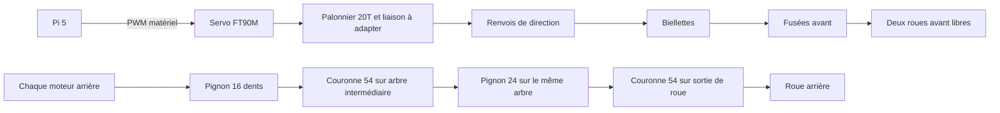

# Intégration de la direction et des réductions

**13 octobre 2026.** Architecture à mettre au point ; aucun câblage exécuté et aucun plan de fabrication définitif créé.

Les deux transmissions sont indépendantes. Deux engrènements extérieurs inversent deux fois le sens : le moteur et sa sortie tournent dans le même sens dans leur repère d'axes parallèles. Le montage gauche/droite doit ensuite être vérifié avec les sens d'avance réels.

## Servo et alimentation

FT90M-C001 de position, palonnier 20T/Ø3,95 : alimentation de travail **6 V**, signal depuis la Pi 5, masse commune. La fiche originale 2020 publiée par FEETECH et hébergée par Gotronic indique 50 Hz, 1000–2000 µs, 1500 µs au neutre et niveau haut 2–5 V. La sortie Pi 3,3 V correspond à ce niveau ; vérifier la révision reçue. Ne pas confondre FT90MR continu, FT90M-FB ni les anciennes versions ayant d'autres plages de commande.

Proposition : **GPIO18 BCM / broche physique 12 / PWM0[2]** ; GPIO12 et GPIO13 restent proposés pour les deux variateurs. Référence du routage : tableau 4 du [document RP1](../raspberry-pi-5/notices/RP1-peripheriques-GPIO-PWM.pdf). Les numéros de broches physiques et BCM sont différents. Vérifier le pilote, la configuration et les impulsions sur les trois canaux ensemble ; la fréquence acceptable par les ESC reste à confirmer.

Pour limiter le coût, **une dérivation du BEC d'un seul ESC, réglé à 6 V**, est la première piste d'alimentation du servo. Il faut mesurer les pointes et la stabilité : servo bloqué annoncé à 1 A, BEC indiqué à 1,5 A dans la notice et 2 A sur la page constructeur. Ce rapprochement ne valide pas automatiquement l'alimentation. Le fil rouge BEC ne doit pas alimenter la Pi ni une GPIO. L'autre BEC reste isolé ; les deux sorties ne sont pas mises en parallèle. La branche Pi 5 reste régulée séparément. Si le BEC ne tient pas les pointes, prévoir et chiffrer une branche servo dédiée.

La fiche servo page 7 montre une résistance de 10 kΩ vers un niveau logique 3,3–5 V. Ne pas la raccorder au rail servo 6 V ni inventer qu'elle est indispensable avec une sortie PWM push-pull. La proposition de raccordement finale sera vérifiée sur la variante reçue.

## Couple de direction : hypothèses pour sélectionner le micro-servo

Hypothèses de travail, **non mesurées** : véhicule 2 kg, 40 % de la masse sur l'avant (0,8 kg), coefficient de frottement 0,8, rayon de déport effectif au sol 4 mm, rapport bras servo/bras de direction 12/10 = 1,2.

Estimation statique simplifiée : T ≈ μ × m_avant × g × r × 1,2 = **0,0301 N·m ≈ 0,307 kgf·cm**. Avec une marge de calcul ×2, environ **0,614 kgf·cm**, inférieur au couple nominal conservateur **0,7 kgf·cm** de la fiche conservée. Ce calcul ignore les efforts dynamiques, variations de charge au freinage, joints et cinématique exacte. Le couple de blocage de 2,3 kgf·cm ne remplace pas le couple nominal. Augmentation du poids ou du déport : recalculer avant de conserver ce servo.

La longueur de 12 mm du bras servo est une cible de géométrie, pas une cote confirmée d'un palonnier livré. Le palonnier micro doit être adapté aux rotules M3 sans supposer qu'une rotule se visse directement dans son trou d'origine.

## Direction mécanique

Choisir deux appuis de pivot par fusée et contrôler le balayage des pneus. Les centres de roue, la voie et l'empattement restent des paramètres de châssis. Pour un modèle cinématique d'Ackermann : **cot(δ_ext) − cot(δ_int) = voie / empattement**. Les deux angles de roue diffèrent ; une traverse n'impose pas automatiquement cette géométrie.

Exemple conditionnel : empattement 220 mm, voie 170 mm, angle intérieur 25° donnent environ 19° à l'extérieur et un rayon au milieu de l'essieu arrière d'environ 0,557 m. Ce petit rayon est destiné aux manœuvres lentes ; il ne définit pas un virage à 40 km/h. Limiter la direction selon la vitesse et mesurer le comportement réel. Les renvois et biellettes nécessitent une cinématique adaptée, pas seulement des longueurs copiées de TT-01R.

## Réductions arrière

Par côté : **16→54**, puis **24→54** sur l'arbre intermédiaire commun. Rapport i = (54/16) × (54/24) = **7,59375**. Module 0,5 ; entraxes primitifs calculés **17,5 mm** et **19,5 mm**, avant réglage du jeu et tolérances. Les dentures des deux étages doivent être dans des plans axiaux distincts.

Avec les roues nominales de 63 mm :

| Grandeur calculée | À 20 km/h | À 40 km/h |
| --- | ---: | ---: |
| Roue | 1 684 tr/min | 3 368 tr/min |
| Arbre intermédiaire | 3 789 tr/min | 7 579 tr/min |
| Moteur nécessaire | 12 789 tr/min | 25 578 tr/min |

4 500 KV ×7,4 V = 33 300 tr/min **à vide, nominalement**. Avec cette réduction, environ 52,1 km/h à vide ; cela ne garantit pas 40 km/h chargé. Le point de fonctionnement, le rendement, les courants et l'autonomie exigent la masse et les efforts réels.

Vérifier l'angle de pression et le contact du couple Losi/KHK ; module identique et alésage correct ne suffisent pas. Vérifier également la largeur utile du pignon, les charges radiales moteur et l'endurance. KHK demande une sélection selon le couple et les conditions de service : les couples catalogue à bas régime ne s'appliquent pas directement au prototype à plusieurs milliers de tr/min. Prévoir carters, lubrification appropriée, jeu, retenues axiales et accès de maintenance.

Les couronnes Ø28 mm laissent théoriquement 17,5 mm entre leur bord et le sol lorsqu'elles sont centrées sur une roue non écrasée de rayon 31,5 mm. Carter, supports et déformation du pneu réduisent cette garde ; ce calcul ne valide pas une implantation.

## Suite de l'étude

Relever pièces et interfaces, construire la nomenclature livrée et le coût de fabrication, fixer la masse et l'implantation. Les [modèles 3D d’étude](3D/README.md) facilitent cette implantation ; ils ne remplacent pas les mesures. Ensuite : plans validés des axes et supports, essais de direction et de réduction, mesures d'énergie et validation de vitesse.
