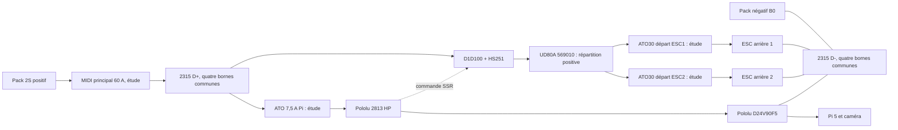

<!-- alimentation-r2 -->
> **Sélection active révisée le 15 octobre 2026.** D+ / D− conservés. F0 devient classe T 50 A. Masse de logique et retours des commandes SSR sur D−, sans parallèle de puissance par B0 d’équilibrage.
> [État électrique courant](../verification-alimentation/README.md) · [Raccordements](../verification-alimentation/integration.md). Les références différentes dans les documents ci-dessous sont historiques. Qualification matérielle non réalisée ; confirmations restantes explicites.
<!-- /alimentation-r2 -->

# Distribution V3 - chemins et affectation

Deux rails séparés : **D+** après le MIDI principal, **D-** au négatif du pack. Sur un rail, les quatre goujons sont communs ; les deux rails ne sont jamais pontés entre eux. Ne pas utiliser un seul 2315 comme quatre bornes isolées.

## Bornes proposées

Numérotation **V3**, de gauche à droite dans le repère CAO ; pas un marquage constructeur. L'affectation privilégie l'arrivée près du centre. Une cosse par goujon dans cette proposition, sauf futur regroupement étudié des auxiliaires de faible courant.

| Rail | Borne / X (mm) | Affectation |
| --- | --- | --- |
| D+ | P1 / -32,385 | Réserve, sans conducteur |
| D+ | P2 / -10,795 | Arrivée après fusible principal |
| D+ | P3 / +10,795 | Tronc moteurs vers borne +2 du D1D100, coordonné avec principal ; fusibles individuels après relais |
| D+ | P4 / +32,385 | Départ protégé vers VIN du Pololu 2813 |
| D- | N1 / -32,385 | Retour puissance ESC 1 |
| D- | N2 / -10,795 | Retour négatif pack B0 |
| D- | N3 / +10,795 | Retour puissance ESC 2 |
| D- | N4 / +32,385 | Retour alimentation électronique et auxiliaires |

Les courants moteurs vont directement au rail D- par leurs fils de puissance. Le retour Pi/régulateur possède son propre conducteur : aucune liaison de puissance moteur à travers le PCB Pi, une GPIO ou un câble USB. Les signaux ESC et servo nécessitent aussi une référence de masse correctement routée ; leur implantation et les chutes de masse doivent être vérifiées au schéma.

Le servo reste alimenté par **un seul BEC à 6 V** ; le fil positif du second BEC est isolé. Aucun 6 V vers les rails 5 V du Pi. L'entrée SSR +3 est commandée par VSW et sa borne 4 revient à B0 ; une GPIO 3,3 V seule ne satisfait pas le seuil minimal publié. La surveillance du pack conserve ses références B0/B1/B2 : **B1 n'est pas un retour de puissance ou le GND du Pi**. Les petits circuits alimentés directement par le port d'équilibrage restent hors de ce tronc et exigent leur protection adaptée.

## Courant, protections et sections

Hypothèse existante : moteurs 40 A au total, Pi/caméra 25 W au 5 V, rendement régulateur 90 %, pack de calcul 6,4 V et auxiliaires 0,05 A. Ainsi `I = 40 + 25/(6,4 × 0,90) + 0,05 = 44,39 A`. Le bus 100 A a une marge nominale pour ce scénario. Cette somme conservatrice inclut des auxiliaires dont le chemin exact reste à finaliser ; leur valeur n'est pas mesurée.

L'intensité admissible réelle dépend des cosses, du contact, des fils, du confinement et de l'air local. Le calibre 100 A est une capacité, pas une protection ou une preuve que tout le faisceau accepte 100 A. La résistance de contact du 2315 n'est pas publiée dans les documents consultés : pas de chute de tension ou perte garantie inventée.

Le MIDI 60 A est près du positif pack, **avant D+**. Le [Blue Sea 5065 et l'ATO 7,5 A du départ Pi](../protection-branche-pi/integration.md) sont retenus pour l'étude, **au début du départ P4**, avant Pololu 2813 et toute réduction de section. Les [deux départs ESC](../protection-branches-moteurs/integration.md) reçoivent chacun un 5065 et un ATO30, après le relais et au début de leur dérivation. La [répartition par UD80A 569010](../repartition-moteurs/integration.md) est retenue, avec une seule arrivée depuis SSR et deux sorties utilisées ; connexions à qualifier. Le tronc commun reste coordonné avec le principal. Qualification des fils ESC 16 AWG, des pointes et du courant prospectif vis-à-vis des 1 000 A des ATO à réaliser ; le principal ne relève pas automatiquement cette limite.

Tronc cuivre 6 mm² repris comme **proposition à qualifier**, pas une section universellement validée. Les cosses doivent convenir au conducteur, au goujon #10-32 et aux dimensions disponibles sous capot. Un oeillet commercial « M5 » peut convenir géométriquement s'il offre le passage nécessaire ; **les écrous M5 × 0,8 ne conviennent pas** aux goujons #10-32. Conserver les écrous fournis, vérifier le diamètre intérieur des cosses et la fermeture du capot après sertissage.

## Montage

1. Batterie et prise d'équilibrage débranchées. Fixer les deux socles sur un support isolant ou avec les distances adéquates aux pièces conductrices ; vis de châssis dans les trous de fixation, jamais sur la barre.
2. Repérer D+ rouge et D- noir, puis chaque conducteur. Monter des cosses serties avec l'outil adapté et isoler les fûts. Poser la cosse sur la barre conductrice, sous la flasque de l'écrou ; ne pas intercaler une rondelle isolante dans le contact.
3. **Couple à confirmer sur le lot :** page 2315 = 15 in-lb / 1,69 N·m sous « screw terminal torque » ; page 2305 = 18 in-lb / 2,03 N·m sous « stud torque ». Valeur de préparation conservatrice 1,69 N·m, sans qualification de tenue mécanique. Résoudre cet écart par la documentation livrée ou une réponse constructeur avant mise en service. Ne pas reprendre les 4,5 N·m du porte-fusible M5.
4. Retenir les câbles hors des borniers pour éviter traction et vibration. Poser les capots ; vérifier leur tenue et la garde aux cosses. Ils ne donnent pas une étanchéité IP démontrée.
5. Avant alimentation, contrôler continuité sur chaque rail, absence de court-circuit D+/D-, polarités, fusibles et sections. Employer ensuite une alimentation limitée pour la première vérification ; essais sous charge et contrôle d'échauffement après validation du faisceau.

Le constructeur évoque au maximum quatre cosses par goujon dans sa FAQ ; cela ne garantit ni leur empilage sous ce capot ni les performances avec nos sections. La proposition reste à une cosse principale par borne. L'implantation CAO, centres Y ±23 mm, est un repère de projet ; la place des fils et la hauteur réelle restent à mesurer.

## Qualification à effectuer

Courants et pointes enregistrés dans les usages prévus ; chute positive et négative mesurée aux raccords ; températures des contacts et fils, tenue des cosses et capots sous vibration, serrage et dégagements. Vérifier les marges sur la durée et l'ambiante retenues. Pas d'essai de court-circuit volontaire du pack. L'autonomie et les 40 km/h demandés ne sont pas démontrés par la seule sélection de ce composant.

[Protection principale](../protection-surintensite/integration.md), [surveillance et coupure](../protection-batterie/integration.md), [thermique du relais](../dissipateur-relais/integration.md).

<!-- faisceau-puissance-v3 -->

Complément du14octobre2026 : [cosses, raccords, gaine, maintien et câble principal](../faisceau-puissance/README.md), avec [raccordements et notice de préparation](../faisceau-puissance/integration.md). Sélection d’étude, sans achat ni qualification matérielle.

<!-- complements-avant-chassis-v3 -->

Mise à jour du 14 octobre 2026 : [coupure ED80 et deux cosses M6](../coupure-manuelle/integration.md) sur le positif commun **après MIDI, avant D+**. Le segment direct CP1+ est remplacé par CP1A+ MIDI→ED80 et CP1B+ ED80→D+. Les deux cosses 95R5 sont réutilisées ; deux 95R6 sont ajoutées. Les anciens PDF/STEP de faisceau ne comprennent pas ce changement et restent des références datées.

[Liaisons alimentation/mesure](../liaisons-alimentation-surveillance/integration.md) et [commandes servo/ESC](../connecteurs-commande/integration.md) détaillent les extrémités aval. L’interface batterie XT60 reste à qualifier ; schéma/routage de surveillance, support caméra, visserie restante et châssis réservés pour la phase finale.

<!-- /complements-avant-chassis-v3 -->

<!-- cordon-principal-batterie-v3 -->
15 octobre 2026 : version active IC5 après le choix utilisateur, pack G1 SPMX50002S30H5 et cordon SPMXCA510 pré-câblé en 10 AWG. CP0+ vers entrée MIDI M5 ; CP0- vers D- N2, avec deux TE 130191. Après MIDI, ED80 et D+ restent en 6 mm². Variante XT60 non retenue ; courant et coordination du MIDI 60 A à qualifier. Charge IC5/S65 distincte à sélectionner avant charge.
<!-- /cordon-principal-batterie-v3 -->
