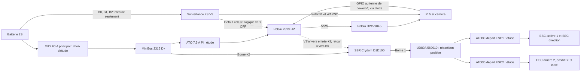

<!-- surveillance-m1 -->
> **15 octobre 2026 - ce concept TLV6700 est historique.** La [surveillance M1 à modules existants](../carte-surveillance-electrique/README.md) définit désormais les seuils, les reprises EVM, les protections fines et le routage. WARN M1 est actif haut ; ne pas reprendre ici la polarité de l’ancien concept. Les Pololu 2813 et D1D100 restent dans la chaîne R2.
<!-- /surveillance-m1 -->

<!-- alimentation-r2 -->
> **Sélection active révisée le 15 octobre 2026.** Modifier l’alimentation de la logique indépendante : depuis le positif après F0 mais avant ED80, à travers une protection auxiliaire à dimensionner, retour vers D−. B0/B1/B2 ne rejoignent que les voies locales isolées ; aucune masse de puissance par l’équilibrage.
> [État électrique courant](../verification-alimentation/README.md) · [Raccordements](../verification-alimentation/integration.md). Les références différentes dans les documents ci-dessous sont historiques. Qualification matérielle non réalisée ; confirmations restantes explicites.
<!-- /alimentation-r2 -->

# Intégration proposée - surveillance et coupure 2S

**Architecture d’étude, pas un faisceau validé ou un PCB prêt à fabriquer.** La carte observe la décharge ; elle n’est ni un chargeur, ni un équilibrage actif, ni une protection contre toutes les défaillances possibles. La charge reste réalisée avec le SkyRC S65, batterie retirée du véhicule.

## Chemins de puissance

**Le Pololu 2813 ne porte pas le courant moteur.** Il porte seulement le régulateur Pi et la commande du SSR. Pour 5 A / 5 V de sortie, 90 % de rendement supposé, 6,4 V d'entrée et 15 mA de commande SSR supposés, le courant d'étude atteint 4,36 A. Le fabricant a mesuré 6 A pour une température MOSFET de 55 °C, à 12 V et dans un air ambiant calme de 22 °C : 55 °C n'est pas la température ambiante, et 6 A n'est pas un seuil de coupure. La résistance et le chauffage à 6,4–8,4 V doivent être mesurés. Utiliser les grands pads et un faisceau de puissance dimensionné ; pas les seuls petits contacts de signal.

Pour une coupure côté positif avec le D1D100 : **borne +2 au positif batterie protégé**, **borne 1 au positif des ESC**. Entrée **+3 àVSW**, **4 àB0**. La polarité est publiée dans le schéma Sensata PDF3 ; ce relais n’est pas un contact mécanique réversible. Une GPIO3,3 V seule est sous le minimum de commande3,5 V : elle ne pilote pas directement ce relais. Le contrôle suit ici la sortie batterie commutée du Pololu.

Prévoir les protections contre les transitoires conformément au fabricant et mesurer la tension des ESC au freinage et à la coupure. Le courant de régénération inverse, les condensateurs des ESC et les chemins de retour doivent être étudiés. Ne pas ajouter une diode ou une TVS sans vérifier sa tension, son énergie et son effet sur le freinage. Le choix des fusibles et des sections reste à terminer avant câblage. Le [HS251 + HSP-1](../dissipateur-relais/integration.md) constitue désormais la sélection de refroidissement d'étude ; qualification thermique à réaliser.

Le [principal MIDI 60 A et son support M5](../protection-surintensite/README.md) ont un dossier d'étude séparé. Ce calibre ne limite pas le courant des moteurs à 40 A et ne remplace pas les protections de départs plus fins. Section et tenue du faisceau, courant prospectif et coordination avec le relais restent à qualifier.

La [distribution D+ / D- par deux MiniBus 2315](../distribution-alimentation/integration.md) est désormais sélectionnée pour l'étude. Les quatre goujons de chaque rail sont communs ; deux pièces indépendantes séparent positif et négatif. Cosses, sections et protections de branches restent à définir.

La [protection du départ Pi](../protection-branche-pi/integration.md) propose le Blue Sea 5065 avec un ATO 7,5 A, avant VIN du Pololu 2813. Les [deux départs moteurs](../protection-branches-moteurs/integration.md) reçoivent chacun un 5065 et un ATO30 après la borne 1 du relais et le [répartiteur UD80A 569010](../repartition-moteurs/integration.md). Calibres, fils ESC 16 AWG, connexions, pointes et pouvoir de coupure de 1 000 A restent à qualifier avec le pack. La perte d'un seul départ doit entraîner un arrêt global supervisé ; aucun retour de fusion n'est fourni par ces pièces.

## Deux références locales de mesure

B0 est le négatif du pack ; B1 son point milieu ; B2 son positif. **Vcell1=B1-B0**, **Vcell2=B2-B1**. Le TLV6700 de la cellule1 est alimenté entre B1 etB0, celui de la cellule2 entre B2 etB1. Leurs sorties passent par des optocoupleurs. Le retour local B1 du second circuit ne doit pas être relié au GND du Pi. Le courant de puissance ne passe jamais dans les fils d’équilibrage.

Par cellule :

| Fonction | Circuit proposé |
| --- | --- |
| Avertissement | INA+ reçoit le pont80,4 kΩ /10 kΩ ; OUTA bas sous le seuil allume l’opto WARN |
| Réserve de coupure | INB- reçoit75,0 kΩ /10 kΩ ; OUTB bas au-dessus du seuil maintient l’opto HEALTHY allumé |
| Défaut indépendant | Sous le seuil, OUTB devient haute impédance ; l’opto HEALTHY s’éteint et son collecteur remonte |
| Filtrage |100 nF près de VDD ;100 nF à chaque entrée de mesure, constante de temps d’environ0,9 ms |

Résistances de mesure **0,1 %**. La valeur80,4 kΩ peut être réalisée avec deux40,2 kΩ en série. Résistances LED proposées1,5 kΩ ; Vishay **VOS618A-8T**, bin CTR130-260 % à1 mA. Ne pas remplacer ce bin par une référence sans bin à faible CTR en supposant les mêmes niveaux. Les limites de saturation, le CTR à la température d’usage et le courant LED doivent être contrôlés sur les pièces reçues.

## Interface logique et maintien après arrêt

La logique indépendante est alimentée en 3,3 V par un **MCP1703AT-3302E/MB (SOT-89)**, alimenté en amont de la coupure depuis B2/B0. Son rôle se limite au circuit de surveillance ; il ne fournit pas l’alimentation du Pi. Capacités entrée/sortie 1 µF à sélectionner selon la fiche Microchip, plus découplages 100 nF. Le suffixe DB correspond au SOT-223, pas au boîtier représenté ici.

Chaque collecteur HEALTHY possède une remontée47 kΩ àcette alimentation. **Deux entrées d’un SN74LVC2G17DCKR** reçoivent ces niveaux ; les deux sorties sont réunies vers OFF par **deux diodes BAT54**, cathodes côté OFF. Une troisième BAT54 reçoit la commande finale du Pi. Il s’agit d’un OU de commandes hautes, pas de sorties GPIO reliées directement ensemble. La résistance de rappel externe OFF proposée100 kΩ est à qualifier avec le réseau d’entrée Pololu.

Les tampons sont nécessaires : l’entrée OFF du Pololu possède un réseau interne10 kΩ/transistor ; une simple remontée47 kΩ depuis les optocoupleurs ne suffit pas à garantir sa commande. Le seuil publié OFF est supérieur à1 V. Les pertes des diodes et les niveaux réels doivent être mesurés. ON et CTRL restent non commandés ; le maintien d’un défaut doit empêcher le réarmement au bouton, point à vérifier au banc et non garanti ici.

Les collecteurs WARN sont séparés : remontée externe47 kΩ au **3,3 V du Pi**, émetteurs au GND Pi. Propositions de broches, non câblées :

| Signal | GPIO BCM | Broche physique | Etat |
| --- | ---: | ---: | --- |
| WARN1 |17 |11 | Bas si cellule1 faible |
| WARN2 |27 |13 | Bas si cellule2 faible |
| Arrêt final |22 |15 | Haut au terme de l’arrêt système, via diode vers OFF |
| Référence |GND |6 ou9 | Masse du système |

Ces GPIO ne chevauchent pas les PWM12/13/18 réservés aux moteurs et au servo. **Les rails de cellule et VSW ne sont pas des signaux GPIO.** Le connecteur logique d’étude porte GND,3V3 Pi,WARN1,WARN2,DONE etOFF ; le repérage doit être confirmé sur un schéma électrique définitif et sur la carte fabriquée.

## Séquence prévue

1. Mise en marche manuelle, contrôle des cellules et initialisation ; moteurs non armés avant commande neutre et autorisation logicielle.
2. En cas de WARN1 ouWARN2, interdire une nouvelle accélération, arrêter les moteurs selon le comportement de freinage vérifié, interrompre l’enregistrement puis demander l’arrêt du système.
3. Au terme de l’arrêt, la GPIO de poweroff commande OFF. Le Pololu coupe le régulateur Pi et le signal du SSR, qui coupe les ESC.
4. Si une cellule atteint auparavant le seuil bas, la voie analogique demande immédiatement OFF. La protection de batterie prend alors la priorité sur l’extinction propre ; celle-ci n’est pas garantie dans ce cas.

Le `gpio-poweroff` officiel démarre inactif et produit un signal actif àl’arrêt. Une piste pour le système reçu est `dtoverlay=gpio-poweroff,gpiopin=22`, polarité haute, **à tester sur Pi5 /OS choisi**. La documentation officielle indique des effets sur la séquence normale d’arrêt et de redémarrage : vérifier reboot, bouton, watchdog et remise sous tension. Aucun réglage n’a été appliqué. La supervision WARN exige un service logiciel qui reste à développer.

La carte reste alimentée par le port d’équilibrage après la coupure et consomme encore du courant. **Débrancher batterie et prise d’équilibrage pour le stockage.** Le montage ne garantit pas une isolation galvanique de toutes les branches et ne remplace pas un arrêt d’urgence. Pololu déconseille explicitement son interrupteur pour une fonction d’arrêt d’urgence ; il est retenu ici comme commande de fonctionnement à qualifier.

## Validation avant fabrication et roulage

Alimentation de laboratoire limitée en courant, deux cellules simulées indépendamment. Mesurer chaque seuil en montée/descente, courant de repos par cellule, fonctionnement avec cellule déséquilibrée, erreur de polarité évitée par repérage, perte de B0/B1/B2 et défaut de source logique. Vérifier OFF pendant défaut maintenu, rebonds et bruit moteur, retour d’alimentation, service bloqué et Pi éteint. Tester ensuite l’arrêt Linux avec caméra active, et le relais àcourants représentatifs avec surveillance thermique. Une alimentation virtuelle àdeux tensions ne remplace pas tous les essais sur batterie.

Il faut encore un schéma électrique détaillé, ERC/DRC, routage, empreintes et choix des protections avant tout Gerber ou usinage CNC. La CAO jointe est destinée àl’implantation mécanique. [Calculs](calculs.json), [index](README.md).

<!-- complements-avant-chassis-v3 -->

Mise à jour du 14 octobre 2026 : [coupure ED80 et deux cosses M6](../coupure-manuelle/integration.md) sur le positif commun **après MIDI, avant D+**. Le segment direct CP1+ est remplacé par CP1A+ MIDI→ED80 et CP1B+ ED80→D+. Les deux cosses 95R5 sont réutilisées ; deux 95R6 sont ajoutées. Les anciens PDF/STEP de faisceau ne comprennent pas ce changement et restent des références datées.

[Liaisons alimentation/mesure](../liaisons-alimentation-surveillance/integration.md) et [commandes servo/ESC](../connecteurs-commande/integration.md) détaillent les extrémités aval. L’interface batterie XT60 reste à qualifier ; schéma/routage de surveillance, support caméra, visserie restante et châssis réservés pour la phase finale.

<!-- /complements-avant-chassis-v3 -->
