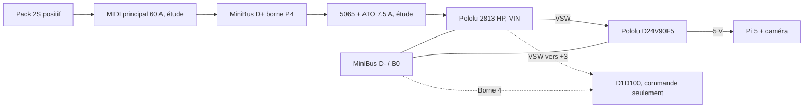

<!-- alimentation-r2 -->
> **Sélection active révisée le 15 octobre 2026.** ATO 7,5 A / Blue Sea 5065 retirés de la sélection active. Nouveau départ : KLKD010.T 10 A et support Midget. Ce calibre d’entrée ne donne pas 10 A à la Pi.
> [État électrique courant](../verification-alimentation/README.md) · [Raccordements](../verification-alimentation/integration.md). Les références différentes dans les documents ci-dessous sont historiques. Qualification matérielle non réalisée ; confirmations restantes explicites.
<!-- /alimentation-r2 -->

# Départ Pi - fusible en série et qualification

Un conducteur rouge du 5065 va à **P4 du rail positif** ; l'autre à **VIN du Pololu 2813**. Le fusible est en série dans ce positif. Aucune de ces deux sorties rouges n'est un retour de masse. Les négatifs restent sur le rail D- ; aucun courant moteur à travers le Pi.

## Implantation et fils

Placer le 5065 **au plus près du début du départ P4**, avant toute réduction de section. Son fil d'arrivée avant le fusible n'est pas protégé par ce petit fusible : conserver ce segment très court, isolé et mécaniquement protégé, puis vérifier sa coordination avec le principal. Les 100 mm de fils de la CAO sont une pose illustrative, pas une longueur imposée de montage.

Fils du support : **12 AWG**, environ 3,31 mm² nominaux. Proposition pour le prolongement batterie vers Pololu : **cuivre 1,5 mm²**, court, avec isolant approprié, cosses et raccords adaptés. Cette section est une proposition à qualifier avec température, longueur, regroupement et courant de défaut ; la section de test 0,75 mm² du fusible n'est pas une garantie d'intensité admissible pour le faisceau V3. La liaison 5 V entre régulateur et Pi est un autre circuit, toujours à dimensionner pour son courant et sa chute de tension.

Sertir les cosses/raccords avec un outil adapté, isoler et retenir les fils. Sur P4, conserver l'écrou **#10-32** du MiniBus ; ne pas utiliser un écrou M5. Son couple reste à confirmer sur le lot, selon le dossier de distribution. Le porte-fusible lui-même n'a pas de borne électrique à vis ; son trou sert seulement à la fixation du capot/support. Diamètre et garde à relever sur pièce avant de percer le châssis.

## Calibre d'étude : 7,5 A

Hypothèse majorante reprise : Pi/caméra capables de demander **25 W au 5 V**, rendement 90 %, pack à 6,4 V. Ajouter **0,015 A** pour l'entrée du D1D100, valeur de travail issue de l'intervalle étudié 10-15 mA. Le Pololu et les pertes de fils ajoutent aussi un faible courant/chute ; ils ne sont pas modélisés dans la première somme.

`I branche ≈ 25 / (6,4 × 0,90) + 0,015 = 4,355 A`.

À 80 % de rendement, la même somme atteint **4,898 A**. Ce sont des hypothèses, pas des consommations mesurées ou une autonomie démontrée. Il faut calculer avec la **tension réellement disponible à VIN après les pertes**, puis mesurer le démarrage et l'utilisation caméra active.

| Calibre ATO | Courant recommandé typique à 20 °C | À 65 °C | À 85 °C |
| --- | ---: | ---: | ---: |
| 5 A | 5 A | 4 A | 4 A |
| **7,5 A** | 7 A | 6 A | 5 A |
| 10 A | 10 A | 8 A | 7 A |

Données de la fiche Littelfuse aftermarket **11/15/2022**, avec ses conditions de connexion et une marge thermique annoncée. Le 5 A n'offre pas la marge souhaitée au scénario chaud ; 7,5 A reste le calibre d'étude. À 85 °C et 80 % de rendement, la marge est faible : revoir thermique et consommation, sans augmenter automatiquement le calibre.

Le **Pololu 2813 ne limite pas le courant**. Le chiffre 6 A correspond à un essai donnant environ **55 °C aux MOSFET**, sous 12 V, ambiante 22 °C, air calme ; ce n'est ni une garantie à 55 °C ambiants ni un seuil de coupure 6 A. Sa tenue à 6,4-8,4 V et dans le châssis doit être qualifiée. Le régulateur possède sa propre limitation/protection : elle peut empêcher le courant d'entrée d'atteindre le seuil de fusion lors d'un défaut de sortie.

## Temps de coupure et limites

| Rapport au calibre | Courant pour 7,5 A | Temps publié pour ce calibre |
| --- | ---: | --- |
| 110 % | 8,25 A | Au moins 360 000 s ; pas de maximum indiqué |
| 135 % | 10,125 A | 0,75 à 600 s |
| 160 % | 12 A | 0,25 à 50 s |
| 200 % | 15 A | 0,15 à 5 s |
| 350 % | 26,25 A | 0,08 à 0,5 s |
| 600 % | 45 A | 0,1 s maximum |

**7,5 A ne signifie pas ouverture immédiate à 7,5 A.** Cette protection est celle d'un départ de fils, pas une garantie de sauver le Pi, le régulateur ou l'interrupteur lors d'une défaillance rapide. Sa résistance typique à froid est 10,91 mΩ : à 4,355 A, environ **47,5 mV et 0,207 W**, hors contacts/fils et augmentation à chaud. Les 116 mV de la fiche sont mesurés dans d'autres conditions, pas remplacés par ce calcul à froid. L'I²t typique de 60 A²s concerne la fusion avant l'arc ; ce n'est pas une garantie d'énergie totale de coupure.

Pouvoir de coupure : **1 000 A à 32 V DC**. Il faut vérifier le courant prospectif de la boucle alimentée par la LiPo, sans court-circuit volontaire. Repère ohmique simplifié : `8,4 V / 1 000 A = 8,4 mΩ`. Pour une estimation du courant **prospectif**, ne pas inclure la résistance du fusible de branche lui-même dans la boucle servant à justifier son pouvoir de coupure. Le « 80C » de la batterie ne donne pas cette mesure.

La présence du principal MIDI de 60 A, annoncé à 2 000 A sur certaines révisions, **ne qualifie pas automatiquement une association en série avec ce petit ATO à 1 000 A**. Courbes et énergies typiques seules ne prouvent ni une tenue combinée ni une sélectivité garantie. Si les données de défaut restent incompatibles, retenir une autre technologie de fusible à pouvoir de coupure adapté avant utilisation.

La fusion du départ Pi peut entraîner la perte de VSW, donc l'extinction de la commande SSR et de l'alimentation Pi. L'arrêt Linux propre n'est pas garanti lors d'une fusion ; freinage, régénération et relais éventuellement défaillant doivent être évalués comme dans les dossiers précédents.

## Pose et essais

1. Débrancher batterie et prise d'équilibrage. Contrôler les références, le calibre brun 7,5 A, les cosses, les sections et l'état des lames/contacts.
2. Fixer et retenir le support, raccorder les deux fils positifs, insérer l'ATO et emboîter entièrement le capot. Protéger des pièces mobiles et de l'humidité ; aucun indice IP du 5065 validé ici.
3. Vérifier continuité du positif et absence de court-circuit vers D-, polarités et absence d'alimentation concurrente du Pi. La première vérification se fait avec une alimentation de laboratoire limitée.
4. Mesurer démarrage, caméra/USB active, fonctionnement continu et accélérations des moteurs : courant d'entrée, creux de VIN, sortie 5 V au Pi, chutes de contact et échauffement du fusible, du Pololu et des fils.
5. Déterminer le courant prospectif et la coordination à partir de données adaptées, sans provoquer un court-circuit du pack. Ne pas mettre sous service le faisceau tant que ces critères ne sont pas validés.

[Distribution](../distribution-alimentation/integration.md), [principal MIDI](../protection-surintensite/integration.md), [surveillance et coupure](../protection-batterie/integration.md), [régulateur Pi](../regulateur-alimentation/README.md).
