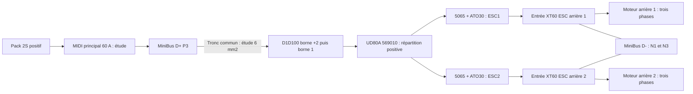

<!-- alimentation-r2 -->
> **Sélection active révisée le 15 octobre 2026.** ATO 30 A / Blue Sea 5065 retirés de la sélection active. Deux KLKD020.T 20 A proposés. Régime continu de dimensionnement : 15 A par ESC ; scénario court 20 A par ESC, 2 s, à tester. Les objectifs de vitesse/autonomie sont conservés.
> [État électrique courant](../verification-alimentation/README.md) · [Raccordements](../verification-alimentation/integration.md). Les références différentes dans les documents ci-dessous sont historiques. Qualification matérielle non réalisée ; confirmations restantes explicites.
<!-- /alimentation-r2 -->

# Protection individuelle des deux alimentations ESC

Les deux fusibles se trouvent **après le relais commun**, un sur chaque positif ESC, **au début de la dérivation**. Les retours négatifs vont séparément vers N1 et N3 du MiniBus D-. Les phases moteur restent reliées directement à leur variateur ; ne pas y insérer ces fusibles.

Le [nVent ERIFLEX UD-80A / 569010](../repartition-moteurs/integration.md) est retenu pour répartir le positif en sortie de la borne 1 du D1D100. Une arrivée 6 mm² proposée et deux petites sorties vers les fils 12 AWG des supports ; un seul conducteur par borne utilisée. Une seule cosse sur la borne SSR dans cette proposition. Quatre sorties restent sans conducteur. Connexions, serrage, retenue et tenue aux défauts à qualifier ; le bloc ne remplace pas les fusibles.

Le tronc commun pack/principal/D+/SSR/répartition doit rester dimensionné et coordonné avec le principal 60 A. Proposition existante : cuivre **6 mm²**, à qualifier. Les arrivées jusqu'aux petits fusibles ne sont pas protégées par ceux-ci : segments courts, isolés et retenus, sans réduction de section non qualifiée. Aucun troisième fusible commun aux moteurs n'est ajouté ici ; sa nécessité devra être revue si la section du tronc commun est réduite.

## Calibre et scénario

Hypothèses séparées : **40 A moteurs au total**, **20 A par ESC** pour cette sélection, air local du relais **40 °C** dans l'étude HS251. Ce ne sont ni des courants mesurés, ni des limites imposées par notre logiciel ou par les fusibles. Un total de 40 A ne garantit pas 20 A maximum sur chaque roue.

| Calibre ATO | Charge typique recommandée à 20 °C | À 65 °C | À 85 °C |
| --- | ---: | ---: | ---: |
| 20 A | 18 A | 15 A | 14 A |
| 25 A | 23 A | 19 A | 18 A |
| **30 A, étude** | **27 A** | **23 A** | **21 A** |

Fiche aftermarket Littelfuse du 15 novembre 2022 ; essais selon connexions et sections indiquées, marge thermique fabricant annoncée. Le 25 A manque de marge à 20 A et 65 °C ; le 30 A est retenu pour l'étude. Les 65 et 85 °C sont des points de comparaison, pas une température visée. Le support est lui aussi limité au calibre 30 A : pas d'augmentation automatique possible.

L'entrée de l'ESC alimentant le servo porte aussi la consommation de son **BEC réglé à 6 V**. Les 20 A de ce départ doivent inclure cette charge et les pertes. Le positif BEC du second ESC reste isolé ; aucun BEC vers le 5 V du Pi.

## Fils et pertes

Le constructeur Hobbywing annonce deux fils d'entrée **16 AWG de 75 mm**, rouge et noir, avec XT60. 16 AWG correspond à environ **1,31 mm² nominal**, contre environ **3,31 mm²** pour le 12 AWG des supports. Ne pas assimiler ces sections ni conclure que l'isolant accepte une température donnée sans son marquage réel.

Les [deux prises XT60H-F avec capots](../connecteurs-alimentation/integration.md) complètent les XT60 à contacts mâles déjà montés sur les ESC. Proposer des queues courtes **12 AWG, environ 3,31 mm²**, compatibles nominalement avec la recommandation AMASS, après chaque ATO30 et sur chaque retour négatif. Les anciens **4 mm²** restent un exemple de pertes ou un tronçon à raccorder par une transition qualifiée : ne pas les forcer dans les godets ni retirer des brins. Longueurs, raccords, isolant et retenue restent à choisir. Cela ne rend pas automatiquement les courts fils 16 AWG de l'ESC aptes au courant ou à l'énergie de défaut d'un ATO30. Leur coordination avec la courbe de coupure et les mesures thermiques reste un critère obligatoire ; réduire le scénario ou revoir la protection si la tenue n'est pas démontrée.

À froid, pour un ATO30 de résistance typique 1,97 mΩ : **20 A → 39,4 mV / 0,788 W par fusible** ; deux fusibles à 20 A → **1,576 W**, hors contacts, fils et chauffage. À 30 A sur un fusible : **59,1 mV / 1,773 W**. Les 84 mV de la fiche correspondent à ses propres conditions d'essai, pas à la simple résistance froide multipliée par le calibre.

Le [BNTECHGO 12 AWG SW12G68008F10C2](../cable-puissance-12awg/README.md) est proposé pour les nouvelles queues : résistance annoncée 5,06 Ω/km, température de référence non précisée. Exemple de boucle 0,20 m positif + 0,20 m retour à 20 A : **40,48 mV / 0,8096 W**, hors pigtails, raccords et échauffement. Cette résistance annoncée ne valide pas un courant admissible ou une tenue au défaut. Les exemples 4 mm² ci-dessous restent des comparaisons.

Exemple calculé pour deux branches neuves identiques, chacune 0,20 m de positif et 0,20 m de retour en cuivre 4 mm² à 20 °C, résistivité supposée 0,0175 Ω·mm²/m : **1,75 mΩ / 35 mV / 0,700 W par boucle à 20 A**. Ajouter les fils 12 AWG du support, les 16 AWG de l'ESC, les connecteurs, les raccords et la température réelle. Les 100 mm représentés dans la CAO ne sont pas une longueur de câble livrée.

## Pointes, défauts et coordination

| Rapport au calibre | Courant ATO30 | Fenêtre d'ouverture publiée |
| --- | ---: | --- |
| 110 % | 33 A | Au moins 360 000 s ; pas de maximum |
| 135 % | 40,5 A | 0,75 à 600 s |
| 160 % | 48 A | 0,25 à 50 s |
| 200 % | 60 A | 0,15 à 5 s |
| 350 % | 105 A | 0,08 à 0,5 s |
| 600 % | 180 A | 0,1 s maximum |

Un fusible 30 A **ne limite pas le courant à 30 A**. À 100 A, la fiche ne donne pas de fenêtre tabulée exacte : ne pas réutiliser celle de 105 A comme une garantie. La durée des « 100 A de pointe » de l'ESC n'est pas publiée ; passage des impulsions et vieillissement du fusible restent à étudier avec le courant d'entrée enregistré et les critères du fabricant.

Pouvoir de coupure **1 000 A à 32 V DC** : établir le courant prospectif de la LiPo et de chaque boucle. Repère purement ohmique **8,4 V / 1 000 A = 8,4 mΩ**. Ne pas inclure la résistance du fusible de branche lui-même pour justifier sa capacité à interrompre le courant prospectif ; ne pas déduire ce courant du marquage « 80C » et ne pas provoquer un court-circuit du pack.

L'I²t typique **1 500 A²s** est celui de fusion avant l'arc. Il ne garantit ni l'énergie totale laissée passer, ni la tenue de l'ESC ou du SSR. Le MIDI principal 60 A ne qualifie pas automatiquement une association avec cet ATO à 1 000 A. Le rapport nominal 60/30 ne prouve pas la sélectivité : celle-ci exige des courbes et données de coordination adaptées. La limite de 40 A continu de l'étude thermique du relais ne devient pas une protection contre 60 A cumulés parce que deux ATO30 sont installés.

## Freinage et arrêt

Vérifier le freinage/régénération, les condensateurs ESC et les transitoires lorsque le relais ou un seul fusible ouvre. Une fusion sur un seul départ peut supprimer la propulsion et le freinage commandé d'une roue, pendant que l'autre fonctionne encore. Ces fusibles n'ordonnent pas à eux seuls l'arrêt du second moteur : prévoir la détection et un arrêt global supervisé au niveau du système. Aucun capteur de courant ou retour de fusion n'est inclus ici.

Un fusible n'est pas un interrupteur d'usage : remplacement uniquement sur pack et prise d'équilibrage débranchés, après recherche de la cause. Ne pas le retirer sous charge.

## Pose et qualification

1. Contrôler références exactes, deux fusibles verts 30 A distincts du brun Pi 7,5 A, lot, cosses, isolant et sections. Mesurer dimensions du support avant perçage.
2. Raccorder chaque support uniquement en série sur son positif, après la répartition commune ; sertir les raccords et retenir les câbles hors des pièces mobiles. Le fusible doit être au début de sa dérivation. Aucun empilage de cosses SSR supposé validé.
3. Vérifier continuité, polarités, isolement et BEC, batterie débranchée ; premier essai avec alimentation limitée, roues dégagées et réglages prudents.
4. Mesurer séparément les deux courants d'entrée et leur somme pendant démarrage, accélération, virage, freinage et marche arrière, puis sur l'usage long. Contrôler chute de tension et échauffement de chaque fusible/contact, fils 16 AWG, XT60 et relais. Ne pas bloquer volontairement le rotor sans protocole adapté.
5. Qualifier courant prospectif, sections, tenue aux défauts, pointes et coordination, ainsi que le comportement lors de la perte d'une seule propulsion. L'autonomie et 40 km/h restent à démontrer.

[Moteurs et notices](../moteur/README.md), [distribution](../distribution-alimentation/integration.md), [principal](../protection-surintensite/integration.md), [Pi](../protection-branche-pi/integration.md), [surveillance et relais](../protection-batterie/integration.md), [refroidissement](../dissipateur-relais/integration.md).

<!-- faisceau-puissance-v3 -->

Complément du14octobre2026 : [cosses, raccords, gaine, maintien et câble principal](../faisceau-puissance/README.md), avec [raccordements et notice de préparation](../faisceau-puissance/integration.md). Sélection d’étude, sans achat ni qualification matérielle.
