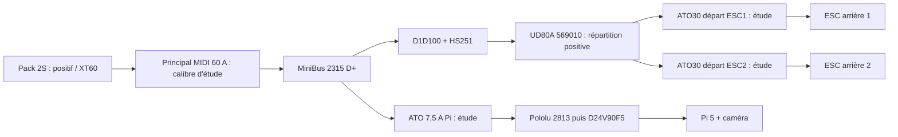

<!-- alimentation-r2 -->
> **Sélection active révisée le 15 octobre 2026.** MIDI 60 A et support M5 retirés de la sélection active. Remplacement proposé : JLLN050.T 50 A et LFT300601C avec capot. Confirmation de la terminaison fine brins avant achat.
> [État électrique courant](../verification-alimentation/README.md) · [Raccordements](../verification-alimentation/integration.md). Les références différentes dans les documents ci-dessous sont historiques. Qualification matérielle non réalisée ; confirmations restantes explicites.
<!-- /alimentation-r2 -->

# Implantation, montage et qualification

Placer le porte-fusible **au plus près de la sortie positive du pack**, à un emplacement fixé, accessible et isolé des éléments conducteurs du châssis. Le segment entre pack et fusible reste sans protection par ce fusible : le garder court et mécaniquement protégé. Le port d'équilibrage et sa surveillance ne passent pas par le courant principal. La charge reste réalisée hors véhicule selon la notice du pack.

## Hypothèses de travail

- Courant continu moteurs d'étude : **40 A au total**, issu de l'enveloppe thermique proposée du D1D100/HS251 ; ce n'est pas un courant imposé ou mesuré.
- Pi + caméra : jusqu'à **25 W** pris comme hypothèse sur le 5 V ; rendement du régulateur **90 % supposé**, batterie **6,4 V** en bas de plage de calcul.
- Réserve auxiliaire : **0,05 A supposé** pour surveillance et commande du relais ; valeur à mesurer.
- Courant principal : `40 + 25 / (6,4 × 0,90) + 0,05 = 44,39 A`.

Le tableau du fabricant donne typiquement 45 A à 65 °C pour un MIDI 50 A, contre 48 A pour un 60 A. Le 50 A laisse très peu de marge sur ce scénario ; le 60 A est donc retenu **pour l'étude**. À 85 °C, le 60 A n'offre plus que 43 A dans ce tableau : le scénario ne rentre plus. Les températures, sections d'essai et connexions du fabricant doivent être prises en compte ; cette comparaison n'est pas une certification du faisceau V3.

Proposition de section du tronc principal : **6 mm² de cuivre**, à confirmer avec le type d'isolant, la longueur, le regroupement, l'air local et les cosses. Le 6 mm² de la fiche du fusible est une **section d'essai**, pas une garantie d'intensité admissible pour tous les fils de cette section. La section et les limites des fils déjà attachés au pack, au XT60 et aux ESC restent à établir. Les protections des départs plus fins doivent être choisies pour chaque départ ; le fusible de 60 A seul ne protège pas la petite branche Pi.

La [branche Pi](../protection-branche-pi/integration.md) dispose d'une sélection d'étude : Blue Sea 5065 et Littelfuse ATO 7,5 A avant le Pololu 2813. Les [deux départs ESC](../protection-branches-moteurs/integration.md) disposent chacun d'un 5065 et d'un ATO30 après le relais commun et le [répartiteur UD80A 569010](../repartition-moteurs/integration.md). Sections, démarrage et coordination restent à qualifier, notamment les fils ESC 16 AWG. Le pouvoir de coupure de 1 000 A des ATO doit être vérifié indépendamment ; le MIDI principal ne garantit ni une capacité de coupure supérieure de l'association ni une sélectivité à partir du seul rapport 60/30. Le SCCR 100 kA conditionnel du répartiteur ne s'applique pas automatiquement à notre MIDI.

## Pertes et pouvoir de coupure

En première approximation à froid : `P = I² × 0,00087` et `U = I × 0,00087`. À 40 A : environ **1,39 W / 34,8 mV** ; à 44,39 A : **1,71 W / 38,6 mV**. Ces valeurs excluent les contacts, cosses et fils, ainsi que l'augmentation de résistance à chaud. La valeur fabricant de 68 mV est donnée dans ses conditions d'essai, elle ne doit pas être remplacée par le seul produit du courant nominal et de la résistance à froid.

La révision récente annonce **2 000 A de pouvoir de coupure à 32 V DC**. La valeur commerciale « 80C » du pack n'est pas une mesure du courant de court-circuit. Un repère purement ohmique est `8,4 V / 2 000 A = 4,2 mΩ` pour la boucle totale ; il ne démontre pas la conformité du pack ou du montage. Établir le courant prospectif avec les données d'impédance de batterie et de boucle, **sans court-circuit volontaire**, et vérifier qu'il reste sous le pouvoir de coupure applicable au lot. La fiche ancienne à 1 000 A doit être distinguée.

Ne pas utiliser l'I²t typique comme une garantie que le fusible protégera le SSR. Il décrit la fusion avant l'arc dans les essais publiés, pas nécessairement toute l'énergie traversante. Coordination avec relais, fils, défauts d'ESC et transitoires à étudier séparément.

## Montage mécanique

Fixer le socle par ses deux trous Ø3,81 ; la visserie de châssis reste à sélectionner. Monter des **cosses à oeillet M5**, adaptées au conducteur et correctement serties, sans brins nus sous les écrous. L'ordre d'empilage exact doit suivre la notice du support et des cosses reçus ; la CAO montre un empilage d'étude **sans cosses** et ne constitue pas cette instruction.

Sur batterie débranchée, installer le fusible et les cosses, utiliser les rondelles prévues, puis appliquer le couple conforme aux pièces : **4,5 N·m retenu dans la plage commune** des références documentées. Replacer le capot et assurer une retenue des câbles qui évite de tirer sur les goujons. Les goujons électriques M5 ne sont pas les fixations au châssis.

## Validation avant mise en service

Vérifier référence/lot du fusible, courant prospectif, sections et cosses ; mesurer courant principal et pointes d'accélération, chutes de tension et échauffement des contacts sous usage prévu. Reproduire l'usage long de 45 minutes et contrôler les marges thermiques. Toute adaptation du calibre nécessite de revoir fils, connexions, courbes et coordination ; ne pas augmenter le fusible pour masquer un défaut.

Cette étape ne produit pas encore un faisceau complet. La [surveillance de batterie](../protection-batterie/integration.md), le [refroidissement du relais](../dissipateur-relais/integration.md), la [distribution par deux MiniBus](../distribution-alimentation/integration.md), les fusibles de départs et la suppression des transitoires restent complémentaires.

<!-- faisceau-puissance-v3 -->

Complément du14octobre2026 : [cosses, raccords, gaine, maintien et câble principal](../faisceau-puissance/README.md), avec [raccordements et notice de préparation](../faisceau-puissance/integration.md). Sélection d’étude, sans achat ni qualification matérielle.

<!-- complements-avant-chassis-v3 -->

Mise à jour du 14 octobre 2026 : [coupure ED80 et deux cosses M6](../coupure-manuelle/integration.md) sur le positif commun **après MIDI, avant D+**. Le segment direct CP1+ est remplacé par CP1A+ MIDI→ED80 et CP1B+ ED80→D+. Les deux cosses 95R5 sont réutilisées ; deux 95R6 sont ajoutées. Les anciens PDF/STEP de faisceau ne comprennent pas ce changement et restent des références datées.

[Liaisons alimentation/mesure](../liaisons-alimentation-surveillance/integration.md) et [commandes servo/ESC](../connecteurs-commande/integration.md) détaillent les extrémités aval. L’interface batterie XT60 reste à qualifier ; schéma/routage de surveillance, support caméra, visserie restante et châssis réservés pour la phase finale.

<!-- /complements-avant-chassis-v3 -->

<!-- cordon-principal-batterie-v3 -->
15 octobre 2026 : version active IC5 après le choix utilisateur, pack G1 SPMX50002S30H5 et cordon SPMXCA510 pré-câblé en 10 AWG. CP0+ vers entrée MIDI M5 ; CP0- vers D- N2, avec deux TE 130191. Après MIDI, ED80 et D+ restent en 6 mm². Variante XT60 non retenue ; courant et coordination du MIDI 60 A à qualifier. Charge IC5/S65 distincte à sélectionner avant charge.
<!-- /cordon-principal-batterie-v3 -->
