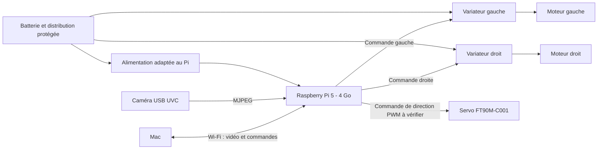

# Intégration V3 - Pi 5 seul pour vidéo et moteurs

Décision du **13 octobre 2026**. Ce document décrit une architecture à mettre au point, pas un câblage déjà testé. Aucune commande ci-dessous n'a été exécutée sur un Pi ou un moteur.

## Architecture fonctionnelle

Le diagramme n'indique pas toutes les masses ni tous les fils. Le faisceau détaillé sera réalisé après vérification des entrées des ESC et de l'alimentation embarquée. Les deux moteurs entraînent les roues arrière ; les deux roues avant non motrices assurent la direction. Le [servo FT90M-C001](../servo-direction/README.md) est choisi pour l'étude ; sa charge et son alimentation restent à valider. Les roues ont leurs propres axes et roulements ; les [transmissions à deux étages](../transmission-arriere/README.md) sont documentées, sans validation physique.

## Deux sorties PWM matérielles

Le RP1 possède un périphérique PWM à quatre canaux indépendants accessible sur la banque GPIO du connecteur. Réserver deux canaux est donc possible. Proposition d'affectation, **non câblée et non testée** :

| Fonction proposée | Numéro GPIO BCM | Broche physique du connecteur 40 broches | Fonction RP1 |
| --- | ---: | ---: | --- |
| Commande du variateur gauche | GPIO12 | 32 | PWM0[0] |
| Commande du variateur droit | GPIO13 | 33 | PWM0[1] |
| Commande du servo de direction FT90M-C001 | GPIO18 | 12 | PWM0[2] |
| Référence de signal commune | GND | 34 | Masse |

Le routage GPIO12/13 est publié dans le tableau 4 de la [documentation RP1](notices/RP1-peripheriques-GPIO-PWM.pdf), page PDF 16. La numérotation GPIO n'est pas la numérotation physique. Confirmer le repérage du connecteur avec la documentation matérielle et la carte reçue avant branchement.

La fréquence, les durées d'impulsion au neutre, en marche avant et au frein, ainsi que les seuils logiques du WP16BL30 G2 ne sont pas encore établis pour notre contrôleur. Ne pas considérer les valeurs usuelles d'autres ESC comme garanties. Confirmer ces paramètres et étalonner chaque variateur avec le signal final.

Configurer le multiplexage et le pilote PWM adaptés au Pi 5 / RP1 dans la version de Raspberry Pi OS choisie. Ne pas figer un numéro `pwmchip`, une bibliothèque ni une ligne de configuration sans essai sur ce système : leur identification dépend du noyau et de la configuration. Mesurer les impulsions avec un oscilloscope ou analyseur logique, notamment pendant une charge vidéo maximale. Le programme de pilotage doit modifier un générateur matériel ; une boucle Python qui bascule une GPIO n'est pas l'implémentation retenue.

## Interface électrique

La direction avant ajoute une troisième commande d'actionneur. Pour le FT90M-C001 documenté, la fiche 2020 donne 50 Hz, 1000–2000 µs et niveau haut 2–5 V ; le 3,3 V du Pi est compatible avec cette spécification, à confirmer sur la révision reçue. Les GPIO ne fournissent pas sa puissance. Voir l'[intégration de la direction](../direction-et-transmission/integration.md) ; coordination des vitesses arrière selon l'angle de direction à développer.

Les sorties GPIO sont en 3,3 V. Vérifier que cette tension est acceptée par les entrées de commande des ESC ; prévoir une adaptation unidirectionnelle si nécessaire. Les masses de signal du Pi et des ESC doivent avoir une référence commune conçue avec la distribution de puissance et le bruit moteur.

Le fil rouge du câble de commande d'un variateur fournit son BEC 6 / 7,4 V : avec le Pi alimenté séparément, l'isoler du Pi. Une dérivation du BEC d'un seul ESC réglé à 6 V est la première piste pour alimenter le servo, sous réserve de mesure des pointes et de stabilité ; l'autre BEC reste isolé. Ne pas relier les deux sorties BEC ensemble et ne pas envoyer cette tension sur les GPIO ou l'alimentation 5 V du Pi. Le fil de programmation jaune ne doit pas être confondu avec la commande d'accélérateur. Voir la [recherche moteur](../moteur/recherche-technique.md).

La [batterie Zeee 2S](../batterie/README.md) alimente les deux ESC par une distribution adaptée aux courants réels. Le Pi et la caméra ont une branche séparée avec le [Pololu D24V90F5](../regulateur-alimentation/README.md), fixé à 5 V. Ce module n’est pas une source USB PD. La proposition actuelle est une alimentation par les rails 5 V des broches physiques 2 et 4, avec plusieurs retours GND, fils courts et protections externes à dimensionner. Une interface USB-C appropriée reste une autre possibilité. Aucun raccordement n’est réalisé.

L’[étude d’alimentation](../alimentation/README.md) conserve le livre blanc Raspberry Pi de 2026 : après qualification de la source, `PSU_MAX_CURRENT=5000` dans l’EEPROM peut déclarer sa capacité et relever automatiquement le plafond des périphériques USB à 1,6 A. Ces réglages ne produisent pas de puissance supplémentaire. Tester tension à la carte, température du régulateur, courant caméra et creux provoqués par les deux moteurs avant de les appliquer.

La [surveillance et la coupure 2S](../protection-batterie/integration.md) proposent maintenant WARN1 sur GPIO17 (broche11), WARN2 sur GPIO27 (broche13) et la commande finale de poweroff sur GPIO22 (broche15), via interface vers OFF du Pololu2813. Les PWM12/13/18 restent distincts. La voie matérielle par cellule peut demander une coupure avant la fin de l’arrêt Linux ; le service de surveillance, l’overlay sur Pi5 et le montage complet restent à vérifier. Aucune configuration n’est appliquée.

## Comportement logiciel à réaliser

1. Démarrer sans armer les moteurs ; n'accepter l'armement qu'après initialisation, commande neutre et action explicite du pilote.
2. Recevoir des commandes datées, détecter leur expiration et commander l'arrêt même si le Wi-Fi reste associé au réseau.
3. Calculer les commandes gauche/droite avec limitation de l'accélération et de la direction selon la vitesse. Deux impulsions identiques ne garantissent pas deux vitesses de roue identiques.
4. Respecter le mode de freinage / marche arrière configuré dans chaque ESC ; ne pas supposer une inversion immédiate.
5. Donner la priorité à l'arrêt si la commande devient invalide, si le service vidéo échoue selon la politique choisie, ou si les conditions de fonctionnement ne sont plus satisfaites.

Services vidéo et moteur séparés, journalisation, supervision et watchdog du Pi sont des pistes à développer. **Une sortie PWM matérielle peut conserver sa dernière commande si le processus ou le système se bloque.** La disparition du Wi-Fi ne signifie pas automatiquement disparition du signal vu par le variateur.

Le neutre peut laisser le véhicule rouler ; il ne doit pas être confondu avec un freinage effectif. Mesurer le comportement en cas d'arrêt du programme, perte réseau, redémarrage et défaut d'alimentation. Un redémarrage par watchdog ne garantit ni un freinage immédiat ni un délai adapté à 40 km/h. Une protection matérielle distincte peut rester nécessaire ; aucun microcontrôleur séparé n'est retenu aujourd'hui. Le fonctionnement à grande vitesse reste conditionné à la validation de l'arrêt et du freinage.

## Première mise en service proposée

Installer Raspberry Pi OS Lite 64 bits avec Raspberry Pi Imager, puis relever modèle, RAM, noyau et versions logicielles. Configurer le pays Wi-Fi France et tester SSH depuis le Mac. Conserver les identifiants réseau dans une configuration locale exclue de Git.

Valider séparément alimentation/refroidissement, caméra et impulsions de commande. Brancher ensuite un variateur puis le second, avec montage fixé et conditions empêchant un départ du véhicule ; appliquer les consignes de la notice moteur, sans essai à vide à plein régime. Passer au roulage lent après calibration et essais de défauts, puis dimensionner les essais à vitesse supérieure.

Guides officiels : [installation du système](https://www.raspberrypi.com/documentation/computers/getting-started.html), [configuration](https://www.raspberrypi.com/documentation/computers/configuration.html), [matériel et GPIO](https://www.raspberrypi.com/documentation/computers/raspberry-pi.html).

<!-- active-cooler-sc1148-v3 -->

Le [SC1148 sélectionné](../refroidissement-raspberry-pi-5/README.md) utilise le connecteur FAN dédié ; les PWM 12/13/18 restent réservés aux actionneurs. Sa [notice de montage et de qualification](../refroidissement-raspberry-pi-5/integration.md) inclut brochage, profil logiciel actuel et budget USB / FAN partagé.

<!-- connecteur-gpio-v3 -->

Le [connecteur Molex 40 positions et faisceau de 15 fils](../connecteur-gpio/integration.md) documente le brochage proposé, les sertissages et les limites des deux arrivées 5 V. Sa notice ne valide pas les 5 A de la branche, les entrées ESC ou la tenue aux vibrations.

<!-- fixations-pi-v3 -->

Les [fixations du Pi](../fixations-raspberry-pi-5/README.md) utilisent un kit Ewwtrey M2.5 nylon noir. Quatre supports MF 10+6 mm constituent seulement le montage de travail ; longueur des vis et hauteur finale à décider lors du châssis, conçu en dernier. Les quatre trous de carte et les deux trous dédiés au cooler ont des fonctions distinctes. Vérifier les dégagements avec tous les composants et câbles ; la validité des STEP ne qualifie pas le montage.

<!-- /fixations-pi-v3 -->
