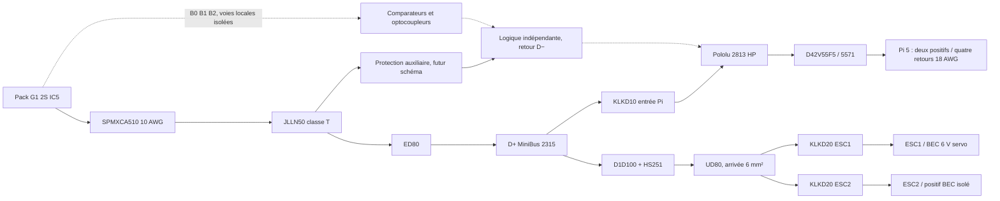

# Raccordements actifs — alimentation R2

Liaisons fonctionnelles avant schéma final. Pack déconnecté pendant préparation. Confirmer les terminaisons des nouveaux supports avant achat.

| Liaison | Fil et terminaison active |
| --- | --- |
| IC5 → entrée F0 | Positif du 510 avec ≥85 mm de conducteur, raccord TE32151, puis extension LAPP6 mm² avec ≥120 mm de conducteur avant F0. Retirer la zone étamée avant sertissage, sans raccourcir sous ces minimums. ATUM8/2 sur le raccord. Pas de cosse M5. Ces longueurs servent à la borne de défaut ; ne pas raccourcir l’ensemble pour l’implantation. |
| IC5 → D− N2 | CP0− 10 AWG ; une TE 130191, œil Ø5,26 mm, ATUM 8/2. Goujon #10-32 avec son écrou. |
| Sortie F0 → ED80 | LAPP 6 mm² ; préparation LFT à confirmer ; Klauke 95R6 à ED80. La 95R5 de sortie MIDI disparaît. |
| ED80 → D+ | LAPP 6 mm² ; 95R6 M6 côté ED80, 95R5 côté MiniBus. Écrou #10-32 conservé. |
| D+ → SSR +2 ; SSR 1 → UD80 | LAPP 6 mm² et cosses suivant les bornes du D1D100. Entrée UD80 IEC ≥6 mm². Polarité SSR respectée. |
| UD80 → F1/F2 → XT60H-F → ESC |12 AWG dans la pression sous vis duL60030M1PQ, plage 10–14 AWG. Prises XT60 des ESC conservées. Les languettes rapides 20 A du support ne sont pas utilisées. |
| Retours ESC → D− | 12 AWG ; retours de propulsion séparés des signaux. Fils d’usine 16 AWG / 75 mm conservés. |
| D+ → FP → 2813 → VIN du régulateur |12 AWG côté FP10 A et dans son supportL60030M1PQ. Après FP, une WAGO221-413 positive relie 12 AWG à 18 AWG vers les grands pads 2813 /régulateur. Le troisième port reste libre. Aucun 18 AWG horsplage dans le support. |
| D− → GND du régulateur /Pi |12 AWG avec cosseAncor 12 AWG au rail ; seconde WAGO221-413 pour 12 AWG depuisD−,18 AWG versGND régulateur et18 AWG vers la 221-415 de répartition Pi. Cette borne ne rejoint jamais le positif. |
| VOUT 5 V → Pi | Deux fils 18 AWG de même longueur ≤50 mm vers les pads des broches physiques 2 et 4 du connecteur déjà soudé sur Pi. Isolation individuelle et maintien hors pad. Aucun courant de puissance par les contacts Molex. |
| GND du régulateur → Pi | Quatre fils 18 AWG ≤50 mm vers les pads 6, 9, 14, 20. WAGO existants pour la répartition, un seul potentiel par boîtier. Liaisons communes régulateur → WAGO également courtes. |
| Molex 40 voies | Seulement 1, 11, 12, 13, 15, 32, 33, 34, 39 : neuf contacts, cinq de réserve. Positions 2/4/6/9/14/20 vides côté fiche de signaux. |
| Commande SSR | +3 sur VSW 2813 ; 4 sur D−. VSW batterie ne rejoint pas une GPIO. |
| Logique indépendante | Positif après F0 / avant ED80 à travers sa protection auxiliaire ; retour D−. MCP1703 et tampons selon futur schéma. Pas d’alimentation numérique depuis B2/B0 de la rallonge d’équilibrage. |

Deux WAGO221-413 sont ajoutées côté entrée Pi ; les WAGO de sortie 5 V/GND déjàprévues restent réutilisées. Aucun nouveaufil 14 AWG nécessaire. Les entrées 12 AWG et sorties 18 AWG restent dans les plages WAGO publiées. Pourles bornes de puissance, préparer selonle fabricant, sansétain souspression.

**Aucun retour électrique par le châssis ni par les fils d’équilibrage.** La borne de défaut devient invalide avec une alimentation ou un retour alternatif. La liaison de charge est débranchée pendant fonctionnement.

Pose du SiF : fixe, protégée contre abrasion, ventilée, avec fils de puissance espacés. Pas de faisceau serré sous mousse. Rayon fixe ≥30 mm. Sa tenue à 180 °C ne définit pas la température admissible du pack ou des composants voisins. Vérifier l’admission des brins ou embouts aux nouvelles bornes LFT / L60030M. Ne pas étamer sous vis et ne pas retirer de brins pour faire entrer un câble.

Couples publiés :LFT60 avec fils 6–14 AWG,2,8 N·m ;L60030M1PQ,2,3 N·m. Ne pas les transposer aux bornes ED80,SSR ou rails. LFT«solid/stranded» ne garantit pas à lui seul l’admission des brins trèsfins : confirmation de terminaison maintenue. Raccord TE32151 selonoutillageSOLISTRAND, pas de pinceuniverselle.

La soudure sur les pads du connecteur Pi exige accès dessous, isolation et maintien ; conserver ses broches existantes. Réserver le passage dans le futur châssis. Ce faisceau est à fabriquer : aucun montage n’a été réalisé.

## Surveillance et voies fines

Prévoir au futur schéma une protection près du pack pour B0/B1/B2, et une protection de l’alimentation auxiliaire après F0. Le principal 50 A ne protège pas ces fils. Cellules et optocoupleurs restent locales ; la logique numérique revient à D−. Dimensionner avec courant de repos, erreur de mesure, défauts et tolérances avant routage. Ces protections ne sont pas encore des composants validés.

## Configuration Pi

Après validation des 5 A et du budget USB/FAN, le livre blanc Raspberry Pi documente `PSU_MAX_CURRENT=5000` dans l’EEPROM, qui relève aussi le plafond USB partagé à 1,6 A. `usb_max_current_enable=1` est l’autre réglage du plafond USB. Ces paramètres ne créent ni source PD ni courant. Aucun réglage appliqué ; aucune alimentation USB-C simultanée.
